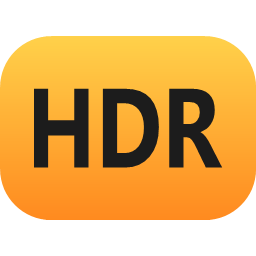

<h1 align="center">
  <br>
  HDR Tray
</h1>

<p align="center"><b>Toggle Windows HDR with a single click on a tray icon.</b></p>

<p align="center">
  <a href="https://github.com/Anzide/HdrTray/releases/latest"></a>
  
  
  <a href="LICENSE"></a>
</p>

<p align="center">
  
</p>

## ✨ Features

- 🖱️ **One click** — left-click the tray icon to switch HDR on or off.
- 🖥️ **Multi-monitor** — toggle every HDR display at once, or each one separately from the menu.
- 🔄 **Always in sync** — follows changes made in Settings or with <kbd>Win</kbd> + <kbd>Alt</kbd> + <kbd>B</kbd> within about 2 seconds.
- 🎨 **Fits the taskbar** — the icon is drawn at your DPI and follows the light / dark taskbar.
- ⌨️ **Scriptable** — `--toggle`, `--on` and `--off` for shortcuts and hotkeys.
- 🪶 **Tiny and portable** — one 55 KB exe. No installer, no admin rights, no background service.
- 🌐 **English and Chinese** — follows the Windows display language.

## 🚦 Icon states

Each icon is shown on a dark and on a light taskbar.

| Icon | Meaning |
| :---: | --- |
|  | HDR is **on** |
|  | HDR is **off** |
|  | HDR is set to on, but **paused** by Windows (for example on battery) |
|  | **No HDR-capable display** is connected |

## 📦 Download

Get `HdrTray.exe` from the [latest release](https://github.com/Anzide/HdrTray/releases/latest) and run it. That is all.

It needs Windows 10 or 11 and .NET Framework 4.8, which Windows already includes.

> [!NOTE]
> Windows 11 puts new tray icons in the `^` overflow area. Drag the HDR icon onto the taskbar to keep it visible.

## 🖱️ Usage

| Action | Result |
| --- | --- |
| **Left-click** | Toggle HDR. With several displays: if any has HDR on, all are turned off; otherwise all are turned on. |
| **Right-click** | Open the menu. |

The menu contains:

- **Turn HDR on / off**
- **One entry per display**, when more than one is connected
- **Display settings…**
- **Start with Windows**
- **Exit**

## ⌨️ Command line

```
HdrTray.exe --toggle   Toggle HDR
HdrTray.exe --on       Turn HDR on
HdrTray.exe --off      Turn HDR off
```

With an argument, HDR Tray does the action once and exits without starting the tray icon. Use it for a desktop shortcut or a hotkey.

| Exit code | Meaning |
| :---: | --- |
| `0` | Success |
| `1` | No HDR-capable display |
| `2` | Invalid argument |
| `3` | The switch failed, or the HDR state could not be read |

`HdrStatus.exe`, also in the release, is an optional read-only diagnostic tool. It prints the HDR state of every display, which is useful in a bug report.

## 🛠️ Build

The build uses the C# compiler that ships with Windows. You do not need an SDK or Visual Studio.

```
powershell -ExecutionPolicy Bypass -File build.ps1
```

The output is in `build\`.
